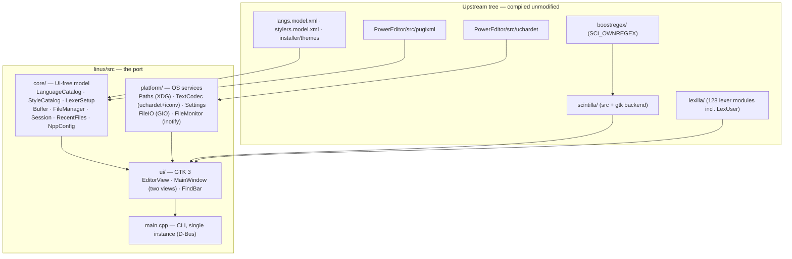

# Notepad++ native Linux port — architecture and plan

Status: **preview** — Phase 0 and Phase 2 (documents and sessions) done;
Phase 1 (upstream core extraction) not started, as it needs upstream PRs
(October 2026, upstream 8.9.8.1 at `946f002`). This document records what the survey of the
upstream source found, the architecture chosen, what the port already does,
and a phased plan to feature parity.

1. [Findings](#1-findings)
2. [Strategy](#2-strategy)
3. [Architecture](#3-architecture)
4. [What works today](#4-what-works-today)
5. [Module map: upstream → port](#5-module-map-upstream--port)
6. [Roadmap](#6-roadmap)
7. [Plugins](#7-plugins)
8. [Upstream-friendly fixes found](#8-upstream-friendly-fixes-found)
9. [Keeping the fork in sync](#9-keeping-the-fork-in-sync)
10. [Testing](#10-testing)

---

## 1. Findings

Upstream application code (`PowerEditor/src`, excluding the bundled
pugixml/uchardet/json) is **~137 k lines in 236 files**, written directly
against Win32: no toolkit, no abstraction layer.

| Indicator (occurrences) | Count |
|---|---:|
| `execute(SCI_…)` (Scintilla calls via `ScintillaEditView::execute`) | 1 935 |
| `wchar_t` / `std::wstring` | 1 614 / 1 020 |
| `WM_*` messages | 1 508 |
| `::SendMessage` | 1 038 |
| `HWND` | 1 021 |
| `GetDlgItem` (dialog controls from `.rc` templates) | 688 |
| `HKEY` / registry | 62 |

What this means:

- **The editing engine is already portable.** Scintilla and Lexilla have a
  first-class GTK backend. Notepad++'s Boost regex engine
  (`boostregex/`) plugs into Scintilla on any platform. All of it builds
  unmodified (two missing-header fixes aside, see §8).
- **Almost all editor behaviour goes through one seam,
  `ScintillaEditView::execute()`**, which calls Scintilla's direct function
  pointer. That mechanism exists unchanged on GTK, so code that only talks
  to Scintilla (search, highlighting, auto-completion, line operations)
  ports with type changes rather than rewrites.
- **The UI is the cost.** About 60 % of the code is dialogs and controls in
  `WinControls/` (43 k lines) plus dialog-driven parts of `Notepad_plus`,
  `FindReplaceDlg`, Preferences and so on, built from `.rc` templates and
  window procedures. There is nothing to reuse there except behaviour and
  layout.
- **Data files are fully reusable**: `langs.model.xml`, `stylers.model.xml`,
  the 22 themes, and by extension `shortcuts.xml`, `userDefineLang.xml`,
  `nativeLang` translations and `functionList/*.xml`. The skeleton already
  loads the first three unmodified.

Win32 density per module (Win32 tokens per 1 000 lines; lower = easier):

| Module | Lines | Win32/kloc | Scintilla calls | Port approach |
|---|---:|---:|---:|---|
| Encoding (`Utf8_16`, `EncodingMapper`) | 1 121 | 0 | – | reuse (replace `_stricmp`, codepage APIs) |
| Highlighters (smart, XML tags) | 947 | 1 | 51 | reuse almost as-is |
| AutoCompletion + FunctionCallTip | 2 035 | 5 | 57 | reuse |
| `Parameters` (config model) | 11 633 | 6 | – | split: XML model reusable, paths/registry → platform |
| `Buffer` / `FileManager` | 2 936 | 7 | 57 | reuse logic, replace file I/O + monitoring |
| `WinControls/FunctionList` (parser) | 2 078 | 35 | 16 | parser reusable, panel rewritten |
| `ScintillaEditView` | 6 115 | 42 | 621 | port: mostly `execute()`, some window code |
| `FindReplaceDlg` | 7 823 | 58 | 165 | split: search engine reusable, dialog rewritten |
| `Notepad_plus` (commands, I/O, notifications) | 23 682 | 26 | 727 | port incrementally behind a UI interface |
| `WinControls/Preference` | 8 393 | 113 | – | rewrite (GtkBuilder), reuse the settings model |
| `WinControls/DockingWnd` | 4 806 | 94 | – | replace with toolkit docking (see §2.3) |
| `NppDarkMode` + `DarkMode/` | 6 319 | 89 | – | drop: GTK themes and theme XML cover it |

---

## 2. Strategy

### 2.1 Options considered

| Option | Effort | Result | Verdict |
|---|---|---|---|
| **Run under Wine** (MinGW build + launcher) | days | Real Notepad++, plugins work; Windows look and feel, Wine dependency | Good for users today; not a port |
| **Winelib** (compile Win32 source against Wine as native ELF) | weeks | Same as Wine but a native binary; still Wine runtime, still Win32 UI | No long-term value over Wine |
| **Own Win32 compatibility shim** | months to years | Re-implementing USER32/COMCTL32 semantics is Wine's job | Rejected |
| **Native toolkit port sharing a UI-free core with Windows** | months, incremental | Native app; shared core keeps parity and mergeability | **Chosen** |

The guiding rule: *move code into a UI-free core that both the Windows build
and the Linux build compile*, rather than forking it. Every extraction should
be an upstreamable refactor on the Windows side.

### 2.2 Toolkit: GTK 3 (for now)

The skeleton uses **GTK 3**:

- Scintilla's GTK backend is its most mature non-Windows backend (SciTE and
  Geany use it), with accessibility, IME and drag-and-drop support.
- Plain C API, small dependency set, available on every distribution;
  `dpkg-shlibdeps` produces a short `Depends:`.
- GtkApplication, GAction and GtkBuilder map well onto Notepad++'s
  command-ID-and-menu model.

Known costs, to revisit at **Phase 4** (docking panels):

- **No docking framework in GTK.** Notepad++'s panels (Function List, Folder
  as Workspace, Document Map, Project panels) need a dock manager. Options:
  `libgdl` (unmaintained), a custom `GtkPaned`-based dock (simpler than it
  sounds, since upstream's own `DockingWnd` is custom too), or switching
  toolkit.
- **GTK 3 is in maintenance mode**; Scintilla has no GTK 4 backend yet.
- **Qt** (Scintilla has a Qt backend, `scintilla/qt`) would give
  `QDockWidget`, `QTabBar`, rich model/view widgets and a macOS path, at the
  cost of a heavier dependency and a C++ ABI for plugins. (Notepadqq, a
  Notepad++-like Linux editor, is Qt-based.)

The layering in §3 keeps this decision cheap: only `linux/src/ui/` is
toolkit-specific.

### 2.3 Strings

Upstream uses `std::wstring` with `L"…"` literals everywhere. On Linux
`wchar_t` is 32-bit UTF-32 rather than 16-bit UTF-16. Rules:

- Shared core code keeps `std::wstring` for now, to minimise diffs against
  upstream. Conversions happen only at the platform boundary (file names,
  GTK labels, GLib), through helpers in `platform/`.
- New port code uses UTF-8 `std::string` and `std::filesystem::path`, which
  is what GTK and the Linux kernel use.
- Never persist `wchar_t` binary data. The plugin ABI must not depend on
  `sizeof(wchar_t)` (§7).

---

## 3. Architecture

### Layers

| Layer | Contains | Depends on | Windows equivalent |
|---|---|---|---|
| `core/` | Language and style catalogues, lexer keyword plans, buffers, load/save and backups, `session.xml`, recent files, `config.xml` import | pugixml, generated tables, `platform/` | parts of `Parameters`, `ScintillaEditView::set*Lexer`, `Buffer`/`FileManager`, `lastRecentFileList` |
| `platform/` | Paths, encoding conversion, file I/O, file monitoring, settings storage | GLib/GIO, uchardet | `GetModuleFileName`, `%APPDATA%`, `MultiByteToWideChar`, `CreateFile`, `ReadDirectoryChangesW`, registry |
| `ui/` | Widgets and windows | GTK, Scintilla GTK, core, platform | `WinControls/`, `Notepad_plus_Window` |

`core/` must stay free of GTK and Win32 includes. That is what lets it later
merge with upstream's own extracted model code (§6, Phase 1).

### Key mechanisms

**`EditorView::execute()`**: the same signature and the same
direct-function-pointer implementation as upstream's
`ScintillaEditView::execute()`. Code that reaches Scintilla only through it
moves over unchanged apart from types (`WPARAM`/`LPARAM` → `uptr_t`/`sptr_t`).

**Generated language table**: `cmake/GenerateLangTable.cmake` extracts
`ScintillaEditView::_langNameInfoArray` (language name → Lexilla lexer) from
upstream source at configure time, so new upstream languages appear without
port changes. The build fails loudly if the table's format changes.

**Lexer keyword plans** (`core/LexerSetup`): upstream's generic `setLexer()`
maps keyword class N to Scintilla keyword set N, but several lexers remap.
The port mirrors upstream exactly for the C family (`cpp` lexer: C, C++, C#,
Java, RC, ActionScript, Swift, Go, JavaScript, TypeScript, with Doxygen
keywords taken from C++), Objective-C, the hypertext family (HTML/PHP/ASP/JSP
with embedded JavaScript, PHP and VBScript keyword sets) and XML. Tests
assert the resulting Scintilla styles.

**Search semantics**: Scintilla is built with `SCI_OWNREGEX` +
`BoostRegexSearch`, the same engine as Windows. `FindBar` passes the same
Notepad++-specific flags per operation as upstream `FindReplaceDlg`
(`SCFIND_REGEXP_EMPTYMATCH_ALL` for Find Next, `…_NOTAFTERMATCH` for Replace
All, `…_SKIPCRLFASONE`), so `^`, lookbehind and `\1` / `$1` substitutions
behave identically. Boost's `format_all` replacement syntax is kept, so
literal parentheses in a replacement are written `\(` `\)`, as on Windows.

**Encodings** (`platform/TextCodec`): BOM detection (UTF-8, UTF-16 LE/BE) →
UTF-8 validation → uchardet (with upstream's TIS-620 exclusion) → iconv via
`g_convert`. Fallback is ISO-8859-1, which round-trips any byte sequence
exactly. Saving to an encoding that can't represent the text fails with a
message instead of silently replacing characters.

**Configuration compatibility**: user overrides use upstream file names
(`~/.config/notepad-plus-plus-gtk/{langs.xml,stylers.xml,themes/}`), so a
`stylers.xml` or theme copied from a Windows installation works as-is. A
Windows `config.xml` placed there is imported on first start (or later via
Settings ▸ Import): session and backup options, auto-detection, tab
settings, auto-indent, wrap/whitespace/indent guides/zoom, the theme (if
installed) and recent files that exist on this system. The port stores its
own settings in `settings.ini`; `config.xml` is only read.

**Documents and views** (Phase 2): a `core::Buffer` is a document
independent of the views showing it, as upstream's `Buffer`. Upstream swaps
one Scintilla document in and out of each of its two views with
`SCI_SETDOCPOINTER`; the port gives every tab its own Scintilla widget, and
a clone (the same buffer in both views) shares the Scintilla document
through the same call. Undo history, markers (bookmarks), save point, lexer
state and read-only flag are therefore shared, while caret, scroll and fold
state stay per view, which is what upstream gets by saving and restoring
`Position` on every switch. Modified state is the document save point plus
`Buffer::forcedDirty` for changes without an undoable edit (encoding
conversion, text restored from a snapshot). A view that loses its last tab
is hidden, and focus moves to the other, as upstream.

**Sessions** (`core/Session`): reads and writes upstream's `session.xml`
schema attribute for attribute (`firstVisibleLine`, `startPos`/`endPos`,
`selMode`, `lang` menu names, `encoding` as a Windows code page,
`backupFilePath`, `originalFileLastModifTimestamp`/`High` as FILETIME,
`Mark`/`Fold` children), including attributes the port does not use yet
(tab colour, pinning, RTL, document map), and keeps
`session.xml.inCaseOfCorruption.bak` like upstream. The same file in both
views restores as a clone. Entries whose file is gone are dropped
(upstream's default `KeepSessionAbsentFileEntries` off).

**Snapshots and periodic backup**: with "Remember current session" and
"Session snapshot and periodic backup" on (upstream defaults), unsaved text
is written every 7 s (`snapshotIntervalMs`) to
`~/.config/notepad-plus-plus-gtk/backup/<name>@<timestamp>`, followed by
`session.xml` (skipped when nothing changed). Exiting then asks nothing;
the next start restores the documents dirty. Snapshot paths read from
`session.xml` must lie inside that folder, as upstream confines
`backupFilePath`. A snapshot of a named file remembers the file's
modification time, so edits made outside meanwhile are reported on restore.
"Backup on save" (simple `.bak` or verbose `nppBackup/…<timestamp>.bak`)
follows upstream naming.

**Outside changes**: each named buffer has a `GFileMonitor`. Events are
filtered by comparing (mtime, size) with the state recorded at load/save,
so the editor's own saves do not count. Questions are asked when the window
is active (upstream behaviour), with upstream's wording; "Update silently"
reloads unmodified documents without asking. Reload keeps caret and scroll
positions in every view.

**Single instance**: `GtkApplication` owns the D-Bus name
`org.notepad_plus_plus.NotepadPlusPlusGtk`; a later invocation forwards its
argument list and working directory (`G_APPLICATION_HANDLES_COMMAND_LINE`)
and exits with the primary's status, so `-n`, `-c`, `-l` and `-ro` apply in
the running window and relative paths resolve where the user typed them.
`-multiInst` starts a separate process; as upstream (`winmain.cpp`), it runs
without a session when another instance exists (checked with
`NameHasOwner`). With no session bus (containers, CI) the editor simply runs
on its own.

---

## 4. What works today

| Area | Status |
|---|---|
| Tabs | ✅ new/open/close, reorder, close button, middle-click close, Ctrl+Tab, tab list menu, context menu (close, close others, copy path/name/dir, open containing folder, read-only, move/clone) |
| Views | ✅ two views side by side; Move / Clone to Other View, Switch to Other View (F8); clones share the document; an empty view hides; split position persisted |
| Files | ✅ open (multi), save, save as, save all, reload (keeps positions), close all, close all but active, drag-and-drop, "new 1" replacement, unsaved-changes prompts, permissions-preserving atomic save (GIO), Edit ▸ Read-Only, Copy to Clipboard (path, name, dir) |
| Sessions | ✅ last session restored at start and saved at exit (`session.xml`, upstream format, both views, positions, bookmarks, folds, language, encoding, read-only); File ▸ Load/Save Session |
| Backup | ✅ session snapshot and periodic backup of unsaved documents (restored dirty, no exit prompt); backup on save (simple / verbose, custom directory via settings) |
| Recent files | ✅ File menu history (closed files, max 10 or `config.xml` value), Restore Recent Closed File (Ctrl+Shift+T), Open All, Empty list; missing files offered for removal |
| External change detection | ✅ `GFileMonitor`: ask to reload (with or without local changes), update silently, deleted-file prompt; Settings ▸ File Status Auto-Detection |
| Single instance | ✅ D-Bus (GApplication): files and switches go to the running window; `-multiInst`, `-nosession` |
| Settings import | ✅ Windows `config.xml` (automatic on first run, or Settings ▸ Import) |
| Command line | ✅ files, `-n<line>` `-c<col>` `-l<lang>` `-ro` `-multiInst` `-nosession`; other upstream switches accepted |
| Syntax highlighting | ✅ all 95 upstream languages via Lexilla, upstream keyword lists and colours |
| Themes | ✅ `stylers.model.xml` + all 22 upstream themes (Settings ▸ Theme), user `stylers.xml`; GTK chrome follows dark themes |
| Encodings | ✅ detect BOM / UTF-8 / legacy (uchardet); convert to UTF-8, UTF-8-BOM, UTF-16 LE/BE BOM |
| Line endings | ✅ detect, convert (Windows / Unix / Mac) |
| Search | ✅ find/replace bar: match case, whole word, Boost regex, wrap, Replace / Replace All (one undo step) |
| Editing | ✅ folding (box tree), brace match, auto-indent, toggle line comment (Ctrl+Q), duplicate/delete/move lines, case conversion, multi-caret and column selection, bookmarks (Ctrl+F2/F2), go to line (Ctrl+G), zoom |
| View | ✅ word wrap, show all characters, indent guides, status bar (language, length/lines, Ln/Col/Sel, EOL, encoding, INS/OVR) |
| Settings | ✅ theme, view toggles, zoom, tab size / replace by spaces, auto-indent, backup and session options, auto-detection mode, window geometry persisted (`settings.ini`) |
| Packaging | ✅ CPack `.deb`, debhelper source package, Docker build/runtime, desktop file, icons, man page |
| Dragging tabs between views, tab pinning/colours, renaming untitled tabs | ❌ later (session attributes are already kept) |
| Find in Files, Mark, Count, results panel | ❌ Phase 3 |
| Macros, Run menu, shortcut mapper | ❌ Phase 3 |
| Auto-completion, call tips, smart highlighting, tag matching | ❌ Phase 1 (code is portable) |
| User Defined Languages | ❌ Phase 3 (lexer already compiled in) |
| Docking panels (Function List, Folder as Workspace, Document Map, Doc List, Char panel, Clipboard History, Project) | ❌ Phase 4 |
| Preferences, Style Configurator dialogs | ❌ Phase 3 |
| Localization (`nativeLang`) | ❌ Phase 3 |
| Printing | ❌ Phase 3 (`GtkPrintOperation` + `SCI_FORMATRANGE`) |
| Plugins | ❌ Phase 5 (§7) |

---

## 5. Module map: upstream → port

| Upstream (PowerEditor/src) | Port location | Notes |
|---|---|---|
| `winmain.cpp` | `src/main.cpp` | CLI parsing compatible with upstream switches; single instance through D-Bus instead of `FindWindow` + `WM_COPYDATA` |
| `Notepad_plus_Window.*` | `ui/MainWindow` | |
| `Notepad_plus.*`, `NppCommands.cpp`, `NppBigSwitch.cpp` | `ui/MainWindow` commands → later `core/Commands` | menu command IDs from `menuCmdID.h` become GAction names; keep IDs for `shortcuts.xml`/macro compatibility |
| `NppIO.cpp` | `ui/MainWindowDocs.cpp` (`openFiles`, `save`, `closeTab`, `loadSession`, `requestQuit`) + `core/FileManager` | |
| `ScintillaComponent/ScintillaEditView.*` | `ui/EditorView` + `core/LexerSetup` | `execute()` seam kept; `position()`/`restorePosition()` mirror upstream `Position` |
| `ScintillaComponent/Buffer.*` | `core/Buffer` + `core/FileManager` | widget per tab; clones share the Scintilla document via `SCI_SETDOCPOINTER` |
| `Notepad_plus.cpp` (`loadSession`, `getCurrentOpenedFiles`, `docGotoAnotherEditView`, `checkModifiedDocument`) | `ui/MainWindowDocs.cpp` | |
| `MISC/Common/lastRecentFileList`, `Parameters` (History) | `core/RecentFiles` | upstream semantics: closed files enter, opened files leave |
| `ScintillaComponent/FindReplaceDlg.*` | `ui/FindBar` (engine functions) | dialog features in Phase 3 |
| `ScintillaComponent/AutoCompletion.*`, `FunctionCallTip.*` | Phase 1: compile into `core/` | reads `autoCompletion/*.xml` |
| `ScintillaComponent/SmartHighlighter.*`, `xmlMatchedTagsHighlighter.*` | Phase 1: compile into `core/` | `execute()` only |
| `ScintillaComponent/UserDefineDialog.*` | Phase 3 | `LexUser.cxx` already builds (empty `windows.h` shim) |
| `Parameters.*` | `core/*Catalog`, `core/Session` (`session.xml`), `core/NppConfig` (`config.xml` import), `platform/Settings` | `shortcuts.xml` in Phase 3 |
| `Utf8_16.*`, `EncodingMapper.*` | `platform/TextCodec` | |
| `MISC/Common/*` | `platform/` | paths, string conversion, file helpers |
| `WinControls/TabBar` | `GtkNotebook` | |
| `WinControls/StatusBar` | `ui/MainWindow` status fields | |
| `WinControls/ToolBar` | `GtkToolbar` | upstream icon sets later (`icons/`) |
| `WinControls/OpenSaveFileDialog` | `GtkFileChooserNative` | portal-aware (Flatpak/Snap-ready) |
| `WinControls/ReadDirectoryChanges` | `platform/FileMonitor` (`GFileMonitor`, inotify) | |
| `WinControls/DockingWnd` | Phase 4: dock manager | see §2.2 |
| `WinControls/Preference` | Phase 3: GtkBuilder dialog | biggest single dialog (8.4 k lines) |
| `WinControls/shortcut` | Phase 3: accel map from `shortcuts.xml` | |
| `MISC/PluginsManager` | Phase 5 | new ABI, §7 |
| `NppDarkMode`, `DarkMode/` | not ported | GTK theme + `gtk-application-prefer-dark-theme` |
| `MISC/RegExt` (file associations) | `.desktop` `MimeType=` | handled by packaging |
| `TrayIcon`, `MiniDumper`, auto-updater (WinGUp) | not ported | distro packaging handles updates |

---

## 6. Roadmap

Each phase ends with something shippable, and the test suite grows with it.

**Phase 0 — groundwork (this delivery).** Build system against the
unmodified tree, editor skeleton, data-file compatibility, `.deb` + Docker,
headless tests.

**Phase 1 — shared core extraction (upstream PRs).** Make the portable
upstream files compile on Linux *in place*, as Windows-neutral refactors
upstream can accept:
- Replace `#include <windows.h>` in model files with narrow headers; move the
  few Win32 calls behind small interfaces (e.g. `IFileSystem`, `IClock`).
- First targets, all with zero to low Win32 use: `Utf8_16`, `EncodingMapper`
  (`_stricmp`), `SmartHighlighter`, `xmlMatchedTagsHighlighter`,
  `AutoCompletion`, `FunctionCallTip`, `functionParser`,
  `lastRecentFileList`.
- Add them to a `npp_core` CMake target shared by both platforms; delete the
  port's duplicates (`core/LexerSetup` becomes upstream's own code).
- Exit: smart highlighting, tag matching, auto-completion and call tips work on
  Linux through upstream code.

**Phase 2 — documents and sessions (done).** `Buffer`/`FileManager`
(documents independent of views), two views with clone and
move-to-other-view, `session.xml`, backup/snapshot, recent files,
`GFileMonitor` change detection, single instance through GApplication
D-Bus, `config.xml` import. See §3 "Key mechanisms" for the design. Left for
later: dragging tabs between views, tab pinning and colours, renaming
untitled tabs, `KeepSessionAbsentFileEntries`, a "Recent Files" submenu
option, and reloading with a chosen encoding (Encoding ▸ Character sets);
the Backup and Auto-Detection options move into the Preferences dialog in
Phase 3.

**Phase 3 — dialogs.** Find/Replace dialog (Find in Files with GIO, Mark,
Count, results panel), Preferences, Style Configurator, Shortcut Mapper
(`shortcuts.xml`), macros (`SCI_STARTRECORD`, stored in `shortcuts.xml`),
Run, Column Editor, UDL dialog, `nativeLang` localization, printing. Build
dialogs with GtkBuilder `.ui` files, so the layout can be edited without
code changes.

**Phase 4 — panels.** Decide on docking (§2.2), then Function List (upstream
parser + `functionList/*.xml`), Folder as Workspace, Document List, Document
Map, Character panel, Clipboard History, Project panels.

**Phase 5 — plugins** (§7).

**Phase 6 — distribution.** Flatpak (portal file chooser already used), Snap,
AppStream metainfo, a PPA, arm64 builds.

---

## 7. Plugins

Windows plugins are DLLs that receive `NppData { HWND _nppHandle,
_scintillaMainHandle, _scintillaSecondHandle }` and drive the host with
`::SendMessage(hwnd, NPPM_* | SCI_*, …)`. Binary compatibility is impossible
on Linux. **Source compatibility for the common case** is achievable:

- Same exported entry points (`setInfo`, `getName`, `getFuncsArray`,
  `beNotified`, `messageProc`, `isUnicode`) from a `.so`.
- `NppData` handles become opaque tokens. The SDK provides
  `SendMessage`/`::SendMessage` that dispatches `NPPM_*` to the host and
  `SCI_*` straight to Scintilla's direct function, so plugins that only use
  messages recompile unchanged.
- Strings: define the SDK's `TCHAR`-equivalent as `char16_t` (UTF-16, the
  same width as Windows) so `NPPM_GETFULLCURRENTPATH` and friends keep their
  buffer-size semantics. Do not use `wchar_t`, which is 4 bytes on Linux.
- Plugins with their own Win32 dialogs need porting. Offer a small GTK dialog
  helper and a docking-panel registration message (`NPPM_DMMREGASDCKDLG`
  equivalent).

---

## 8. Upstream-friendly fixes found

Found while building upstream sources with GCC on Linux. Each is worked
around in `linux/cmake/` without patching upstream files, and each is a
one-line upstream PR:

1. `scintilla/include/Sci_Position.h` uses `intptr_t` but includes only
   `<stddef.h>` (Notepad++'s change of `Sci_PositionCR`). Add
   `#include <stdint.h>`.
2. `PowerEditor/src/uchardet/nsCharSetProber.cpp` uses `uintptr_t` without
   `<stdint.h>`.
3. `lexilla/lexers/LexUser.cxx` includes `<windows.h>` but uses no Win32
   API; it needs `<cstring>` and a portable replacement for `_itoa`
   (`snprintf`).
4. `PowerEditor/src/EncodingMapper.cpp` uses `_stricmp` (use a portable
   case-insensitive compare).

---

## 9. Keeping the fork in sync

- The port is self-contained in `linux/`: no upstream file is modified.
  Merging upstream `master` is conflict-free unless upstream adds its own
  `linux/` directory.
- Things that track upstream automatically: the version (from `resource.h`),
  the language table (generated from `ScintillaEditView.cpp`), the language,
  style and theme data, and the Scintilla/Lexilla/Boost sources.
- Things that need attention on merge: `linux/debian/changelog` (CMake warns
  when it lags), new lexer remaps in upstream `ScintillaEditView::set*Lexer()`
  (mirror them in `core/LexerSetup.cpp`), and new upstream fixes for the items
  in §8 (drop the corresponding workaround).
- Suggested CI: `.github/workflows/linux-gtk.yml` builds with `-Werror`, runs
  the tests under Xvfb, builds both `.deb` routes, and installs the result on
  a clean container.

---

## 10. Testing

`ctest` (headless via `xvfb-run` when there is no display):

- `unit_and_widget`: language and style catalogues, extension and
  file-name detection, codec round-trips (UTF-8, BOM, UTF-16, Latin-1,
  unrepresentable characters), a live Scintilla widget (Lexilla styles for
  C++, HTML+JS and Python, upstream colours), Boost regex (lookbehind,
  backreferences, invalid patterns, `^` empty matches), wrap-around search,
  toggle comment, auto-indent, EOL detection, bookmarks, and parsing of every
  bundled theme.
- `documents_and_sessions`: recent-files semantics, code page mapping,
  FILETIME round trip, `session.xml` write/read round trip, snapshot path
  confinement, backup-on-save naming, `config.xml` import; then a live
  `MainWindow` with scripted answers to its questions: clones share one
  document and close without asking, move/switch views, empty views hide,
  close/cancel prompts, recent list on close and restore, read-only, a
  two-view session round trip (positions, bookmarks, clone, active view),
  dropped missing files, snapshots restored dirty with no exit prompt and
  removed on save/close, exit prompts without snapshots, outside changes
  (own saves ignored, reload keeps the caret, decline, silent update,
  deleted file), and legacy code pages kept across sessions.
- `app_launch`: starts the real application (`-multiInst`) with a file and
  `-n3`, then exits after 1.5 s through the normal exit path.
- `single_instance`: on a private bus from `dbus-run-session`, a second
  invocation with a relative path hands over in well under a second and the
  file shows up in the primary's session; a `-multiInst` instance must not
  write the session. Skipped without `dbus-run-session`.
- `app_version`: CLI smoke test.

As upstream code moves into the shared core (Phase 1), its behaviour gets
tested on Linux by the same suite. Port the upstream `PowerEditor/Test`
function-list and UDL fixtures as they become runnable.
