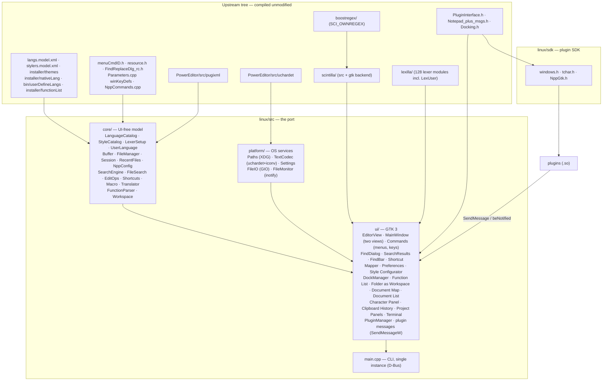

# Notepad++ native Linux port — architecture and plan

Status: **preview** — Phases 0 and 2–6 done (documents and sessions,
dialogs, panels, plugins, distribution); Phase 1 (upstream core extraction)
not started, as it needs upstream PRs
(October 2026, upstream 8.9.8.1 at `946f002`). This document records what the survey of the
upstream source found, the architecture chosen, what the port already does,
and a phased plan to feature parity.

1. [Findings](#1-findings)
2. [Strategy](#2-strategy)
3. [Architecture](#3-architecture)
4. [What works today](#4-what-works-today)
5. [Module map: upstream → port](#5-module-map-upstream--port)
6. [Roadmap](#6-roadmap)
7. [Plugins](#7-plugins)
8. [Upstream-friendly fixes found](#8-upstream-friendly-fixes-found)
9. [Keeping the fork in sync](#9-keeping-the-fork-in-sync)
10. [Testing](#10-testing)

---

## 1. Findings

Upstream application code (`PowerEditor/src`, excluding the bundled
pugixml/uchardet/json) is **~137 k lines in 236 files**, written directly
against Win32: no toolkit, no abstraction layer.

| Indicator (occurrences) | Count |
|---|---:|
| `execute(SCI_…)` (Scintilla calls via `ScintillaEditView::execute`) | 1 935 |
| `wchar_t` / `std::wstring` | 1 614 / 1 020 |
| `WM_*` messages | 1 508 |
| `::SendMessage` | 1 038 |
| `HWND` | 1 021 |
| `GetDlgItem` (dialog controls from `.rc` templates) | 688 |
| `HKEY` / registry | 62 |

What this means:

- **The editing engine is already portable.** Scintilla and Lexilla have a
  first-class GTK backend. Notepad++'s Boost regex engine
  (`boostregex/`) plugs into Scintilla on any platform. All of it builds
  unmodified (two missing-header fixes aside, see §8).
- **Almost all editor behaviour goes through one seam,
  `ScintillaEditView::execute()`**, which calls Scintilla's direct function
  pointer. That mechanism exists unchanged on GTK, so code that only talks
  to Scintilla (search, highlighting, auto-completion, line operations)
  ports with type changes rather than rewrites.
- **The UI is the cost.** About 60 % of the code is dialogs and controls in
  `WinControls/` (43 k lines) plus dialog-driven parts of `Notepad_plus`,
  `FindReplaceDlg`, Preferences and so on, built from `.rc` templates and
  window procedures. There is nothing to reuse there except behaviour and
  layout.
- **Data files are fully reusable**: `langs.model.xml`, `stylers.model.xml`,
  the 22 themes, and by extension `shortcuts.xml`, `userDefineLang.xml`,
  `nativeLang` translations and `functionList/*.xml`. The skeleton already
  loads the first three unmodified.

Win32 density per module (Win32 tokens per 1 000 lines; lower = easier):

| Module | Lines | Win32/kloc | Scintilla calls | Port approach |
|---|---:|---:|---:|---|
| Encoding (`Utf8_16`, `EncodingMapper`) | 1 121 | 0 | – | reuse (replace `_stricmp`, codepage APIs) |
| Highlighters (smart, XML tags) | 947 | 1 | 51 | reuse almost as-is |
| AutoCompletion + FunctionCallTip | 2 035 | 5 | 57 | reuse |
| `Parameters` (config model) | 11 633 | 6 | – | split: XML model reusable, paths/registry → platform |
| `Buffer` / `FileManager` | 2 936 | 7 | 57 | reuse logic, replace file I/O + monitoring |
| `WinControls/FunctionList` (parser) | 2 078 | 35 | 16 | parser reusable, panel rewritten |
| `ScintillaEditView` | 6 115 | 42 | 621 | port: mostly `execute()`, some window code |
| `FindReplaceDlg` | 7 823 | 58 | 165 | split: search engine reusable, dialog rewritten |
| `Notepad_plus` (commands, I/O, notifications) | 23 682 | 26 | 727 | port incrementally behind a UI interface |
| `WinControls/Preference` | 8 393 | 113 | – | rewrite (GtkBuilder), reuse the settings model |
| `WinControls/DockingWnd` | 4 806 | 94 | – | replace with toolkit docking (see §2.3) |
| `NppDarkMode` + `DarkMode/` | 6 319 | 89 | – | drop: GTK themes and theme XML cover it |

---

## 2. Strategy

### 2.1 Options considered

| Option | Effort | Result | Verdict |
|---|---|---|---|
| **Run under Wine** (MinGW build + launcher) | days | Real Notepad++, plugins work; Windows look and feel, Wine dependency | Good for users today; not a port |
| **Winelib** (compile Win32 source against Wine as native ELF) | weeks | Same as Wine but a native binary; still Wine runtime, still Win32 UI | No long-term value over Wine |
| **Own Win32 compatibility shim** | months to years | Re-implementing USER32/COMCTL32 semantics is Wine's job | Rejected |
| **Native toolkit port sharing a UI-free core with Windows** | months, incremental | Native app; shared core keeps parity and mergeability | **Chosen** |

The guiding rule: *move code into a UI-free core that both the Windows build
and the Linux build compile*, rather than forking it. Every extraction should
be an upstreamable refactor on the Windows side.

### 2.2 Toolkit: GTK 3 (for now)

The skeleton uses **GTK 3**:

- Scintilla's GTK backend is its most mature non-Windows backend (SciTE and
  Geany use it), with accessibility, IME and drag-and-drop support.
- Plain C API, small dependency set, available on every distribution;
  `dpkg-shlibdeps` produces a short `Depends:`.
- GtkApplication, GAction and GtkBuilder map well onto Notepad++'s
  command-ID-and-menu model.

Known costs, revisited at **Phase 4** (docking panels):

- **No docking framework in GTK.** Notepad++'s panels (Function List, Folder
  as Workspace, Document Map, Project panels) need a dock manager. Options
  were `libgdl` (unmaintained), a custom `GtkPaned`-based dock (upstream's
  own `DockingWnd` is custom too), or switching toolkit. **Decision (Phase
  4): the custom dock** (`ui/DockManager`, §3). Four sides of nested
  `GtkPaned`s, each a `GtkNotebook` in one tab group: GTK's own tab
  drag-and-drop moves a panel between sides, and dropping it outside the
  window floats it, which covers what upstream's gripper does in about 500
  lines. GTK 3 stays.
- **GTK 3 is in maintenance mode**; Scintilla has no GTK 4 backend yet.
- **Qt** (Scintilla has a Qt backend, `scintilla/qt`) would give
  `QDockWidget`, `QTabBar`, rich model/view widgets and a macOS path, at the
  cost of a heavier dependency and a C++ ABI for plugins. (Notepadqq, a
  Notepad++-like Linux editor, is Qt-based.)

The layering in §3 keeps this decision cheap: only `linux/src/ui/` is
toolkit-specific.

### 2.3 Strings

Upstream uses `std::wstring` with `L"…"` literals everywhere. On Linux
`wchar_t` is 32-bit UTF-32 rather than 16-bit UTF-16. Rules:

- Shared core code keeps `std::wstring` for now, to minimise diffs against
  upstream. Conversions happen only at the platform boundary (file names,
  GTK labels, GLib), through helpers in `platform/`.
- New port code uses UTF-8 `std::string` and `std::filesystem::path`, which
  is what GTK and the Linux kernel use.
- Never persist `wchar_t` binary data. The plugin interface keeps
  `wchar_t`, which is UTF-32 on Linux: plugins are rebuilt from source, so
  only source compatibility matters, and `L""`/`wcs*` code keeps working
  (§7).

---

## 3. Architecture

### Layers

| Layer | Contains | Depends on | Windows equivalent |
|---|---|---|---|
| `core/` | Language and style catalogues, lexer keyword plans, User Defined Languages, buffers, load/save and backups, `session.xml`, recent files, `config.xml` import; search engine and Find in Files, Edit menu operations, `shortcuts.xml` (keys, macros, Run commands), `nativeLang` | pugixml, generated tables, Scintilla's message API (`core::Sci`), `platform/` | parts of `Parameters`, `ScintillaEditView`, `Buffer`/`FileManager`, `lastRecentFileList`, the engine half of `FindReplaceDlg`, `Sorters`, `NativeLangSpeaker` |
| `platform/` | Paths, encoding conversion, file I/O, file monitoring, settings storage | GLib/GIO, uchardet | `GetModuleFileName`, `%APPDATA%`, `MultiByteToWideChar`, `CreateFile`, `ReadDirectoryChangesW`, registry |
| `ui/` | Widgets and windows | GTK, Scintilla GTK, core, platform | `WinControls/`, `Notepad_plus_Window` |

`core/` must stay free of GTK and Win32 includes. That is what lets it later
merge with upstream's own extracted model code (§6, Phase 1). Core code that
needs a Scintilla talks to it through `core::Sci`, a direct-function pointer
pair (the `execute()` seam below), so the same search, Edit and macro code
runs on a visible editor, on a hidden one (Find in Files) and in tests.

### Key mechanisms

**`EditorView::execute()`**: the same signature and the same
direct-function-pointer implementation as upstream's
`ScintillaEditView::execute()`. Code that reaches Scintilla only through it
moves over unchanged apart from types (`WPARAM`/`LPARAM` → `uptr_t`/`sptr_t`).

**Generated language table**: `cmake/GenerateLangTable.cmake` extracts
`ScintillaEditView::_langNameInfoArray` (language name → Lexilla lexer) from
upstream source at configure time, so new upstream languages appear without
port changes. The build fails loudly if the table's format changes.

**Lexer keyword plans** (`core/LexerSetup`): upstream's generic `setLexer()`
maps keyword class N to Scintilla keyword set N, but several lexers remap.
The port mirrors upstream exactly for the C family (`cpp` lexer: C, C++, C#,
Java, RC, ActionScript, Swift, Go, JavaScript, TypeScript, with Doxygen
keywords taken from C++), Objective-C, the hypertext family (HTML/PHP/ASP/JSP
with embedded JavaScript, PHP and VBScript keyword sets) and XML. Tests
assert the resulting Scintilla styles.

**Search semantics** (`core/SearchEngine`): Scintilla is built with
`SCI_OWNREGEX` + `BoostRegexSearch`, the same engine as Windows. The engine
passes the same Notepad++-specific flags per operation as upstream
`FindReplaceDlg` (`SCFIND_REGEXP_EMPTYMATCH_ALL` for Find Next,
`…_NOTAFTERMATCH` for Replace All / Count / Mark, `…_SKIPCRLFASONE`), uses
upstream's scopes (direction, wrap, In selection) and Extended-mode escapes,
so `^`, lookbehind, empty matches and `\1` / `$1` substitutions behave
identically. Boost's `format_all` replacement syntax is kept, so literal
parentheses in a replacement are written `\(` `\)`, as on Windows. The Find
dialog, the incremental search bar, Style tokens, macros and Find in Files
all use this one engine.

**Find in Files** (`core/FileSearch`): upstream's filter syntax (`*.cpp *.h`,
`!*.bak`, `!\dir`, `!+\dir` for all levels), hidden folders skipped unless
asked, binary files skipped. Each file is searched in a hidden Scintilla
document with the engine above; a file that is open is searched (or
replaced) as it is in the editor, as upstream does. Replace in Files writes a
file back in its own encoding and line endings, and only when something
changed. Results go to the **search results panel** (`ui/SearchResults`), a
read-only Scintilla coloured by Lexilla's `searchResult` lexer, with
upstream's text format, newest search on top and older ones folded, so it
looks like upstream's Finder and themes style it the same way.

**Commands and menus** (`ui/Commands`): every menu command is keyed by its
upstream ID from `menuCmdID.h` (compiled unmodified) and becomes a window
action `win.id<ID>`. The menu bar follows upstream `Notepad_plus.rc`
(`buildMenuBar`), labels come from `nativeLang` by the same IDs, and a
command the port does not implement is left out of the menus rather than
shown disabled. `cmake/GenerateCommandTables.cmake` extracts upstream's
default shortcuts (`winKeyDefs[]` in `Parameters.cpp`, with virtual-key
values from `keys.h`) and the list of commands macros record (from
`NppCommands.cpp`) at configure time, like the language table. Commands are
implemented in `ui/MainWindowCommands.cpp` (the GTK side of
`NppCommands.cpp`); the Edit menu's text operations (case, sort, trim,
tab/space, duplicates, comments, bookmarked lines, column insertion) are UI-free in
`core/EditOps`, with upstream's line ranges, sort orders (natural integer
sort, decimal sorts that put blank lines first) and undo grouping.

**Keys, macros and Run commands** (`core/Shortcuts`, `core/Macro`):
`shortcuts.xml` is read and written in upstream's format; customised menu
keys apply on top of upstream's defaults, and the `PluginCommands` and
`ScintillaKeys` sections are kept verbatim. Keys are Windows virtual-key
codes in the file and become GTK accelerators through `ui/KeyMap`, so a
`shortcuts.xml` copied from Windows works. Macros are recorded as upstream
steps: Scintilla messages (`SCN_MACRORECORD`), menu commands by ID (type 2)
and Find/Replace operations as upstream's sequence of type 3 steps
(`IDC_FRCOMMAND_INIT` … `IDC_FRCOMMAND_EXEC`), so macros move between Windows
and Linux unchanged; a recorded menu command is not recorded twice through
the Scintilla messages it sends. Run commands expand upstream's variables
(`$(FULL_CURRENT_PATH)`, `$(CURRENT_WORD)`, `$(SYS.<var>)` …) and start the
program with `g_spawn`, or open documents and URLs with the desktop's
handler, as `ShellExecute` does.

**Localization** (`core/Translator`): upstream's `nativeLang/*.xml` load
unmodified, on top of `english.xml` so a translation's gaps fall back to
English. Menus, dialogs, status and message texts are looked up by upstream
IDs and keys; `&` mnemonics become GTK `_` mnemonics. Switching language
(Preferences ▸ General) rebuilds the menus at once, and right-to-left
languages flip the window. As upstream, English uses the code's own
texts where `english.xml` lacks plural forms (search results counts).

**User Defined Languages** (`core/UserLanguage`): `userDefineLang.xml`,
`userDefineLangs/*.xml` in the config folder and the shipped ones (the
preinstalled Markdown) are read with upstream's parsing rules, old UDL
versions included, and drive Lexilla's `user` lexer with exactly the
properties and keyword lists `ScintillaEditView::setUserLexer` sends
(quoted keywords encoded the same way). Language detection follows upstream
order: a UDL's extensions (the dark or light variant matching the theme),
then the Style Configurator's "User ext.", then the built-in languages.
Sessions store a UDL by name, as upstream.

**Device Tree** (`.dts`, `.dtsi`, `.dtso`): upstream has no lexer for it.
The UDL (`userDefineLangs/devicetree._preinstalled*.udl.xml`, light and
dark) and its Function List rules (`functionList/devicetree.xml`,
associated in `overrideMap.xml`) were added to the upstream tree, like the
preinstalled Markdown, so the port only reads them. The `.desktop` file
claims `text/x-devicetree-source`.

**Docking panels** (`ui/DockManager`, Phase 4): see §2.2 for the choice.
Each side shows its panels as notebook pages with upstream's caption bar
(title, a menu to dock to another side or float, close) and tabs underneath
when there are several. The layout (side, order, shown, floating window
geometry, side sizes) is kept in `settings.ini` `[Docking]`, as upstream
keeps it in `config.xml`. The search results are a panel too, docked at the
bottom. Panels follow the active document: the Function List re-parses a
second after typing stops, the Document Map shares the editor's Scintilla
document (`SCI_SETDOCPOINTER`) and draws upstream's view zone on an overlay
(markers or indicators would show in the editor too), the Document List
tracks tabs and their modified state, the Character Panel the document's
code page.

**Function List** (`core/FunctionParser`): upstream's `functionParser.cpp`
ported to `core::Sci`; it already reached Scintilla only through
`searchInTarget`, so the zone / unit / mixed parsers, comment zones and
nested class scans are the same code paths with the same Boost regex flags.
Rules are upstream's `functionList/*.xml` with `overrideMap.xml`
(language IDs map onto the generated language table, which is in
`LangType` order); the user's `functionList/` folder overrides the shipped
one. The 44 fixtures of upstream's own unit test
(`PowerEditor/Test/FunctionList`) run in the test suite and produce
exactly upstream's expected JSON. The preinstalled Markdown UDL lists its
headings (`functionList/markdown.xml`, ATX and Setext, skipping fenced
code, HTML comments and front matter), added to the upstream tree like
the Device Tree rules. The port's panel shows them as an outline: each
heading under the last one of a higher level, Sort ordering each level,
the filter keeping matches under their nearest shown parent (upstream's
panel would list them flat; the parse results, and so the fixtures, are
upstream's).

**Folder as Workspace and Project Panels**: folders are listed lazily and
refreshed through `GFileMonitor`, and the roots, expanded folders and
selection go into `session.xml` `<FileBrowser>` in upstream's format, so a
session from Windows restores them (paths permitting). Project Panels read
and write upstream `.workspace` files (`core/Workspace`), with file names
relative to the workspace and Windows backslashes accepted; each panel's
workspace file is remembered, and a changed workspace is offered for saving
on exit.

**Dialogs**: Find/Replace, Shortcut Mapper, Preferences, Style
Configurator, Run, Column Editor and Run a Macro Multiple Times are built
in C++ rather than from GtkBuilder `.ui` files as first planned: every label
comes from `nativeLang` by upstream control ID, so a `.ui` file would hold
only layout, and code keeps one place to change per dialog. Preferences
apply at once and Style Configurator edits preview live, as upstream; the
Style Configurator saves into a copy of the file the styles came from
(`stylers.xml` or the user's copy of a theme), so attributes the port does
not model survive. Printing uses `GtkPrintOperation`, with Scintilla laying
out pages into the print context's cairo surface (`SCI_FORMATRANGEFULL`), as
upstream does with a printer DC.

**Encodings** (`platform/TextCodec`): BOM detection (UTF-8, UTF-16 LE/BE) →
UTF-8 validation → uchardet (with upstream's TIS-620 exclusion) → iconv via
`g_convert`. Fallback is ISO-8859-1, which round-trips any byte sequence
exactly. Saving to an encoding that can't represent the text fails with a
message instead of silently replacing characters.

**Configuration compatibility**: user overrides use upstream file names
(`~/.config/notepad-plus-plus-gtk/{langs.xml,stylers.xml,themes/}`), so a
`stylers.xml` or theme copied from a Windows installation works as-is. A
Windows `config.xml` placed there is imported on first start (or later via
Settings ▸ Import): session and backup options, auto-detection, tab
settings, auto-indent, wrap/whitespace/indent guides/zoom, the theme (if
installed) and recent files that exist on this system. The port stores its
own settings in `settings.ini`; `config.xml` is only read.

**Documents and views** (Phase 2): a `core::Buffer` is a document
independent of the views showing it, as upstream's `Buffer`. Upstream swaps
one Scintilla document in and out of each of its two views with
`SCI_SETDOCPOINTER`; the port gives every tab its own Scintilla widget, and
a clone (the same buffer in both views) shares the Scintilla document
through the same call. Undo history, markers (bookmarks), save point, lexer
state and read-only flag are therefore shared, while caret, scroll and fold
state stay per view, which is what upstream gets by saving and restoring
`Position` on every switch. Modified state is the document save point plus
`Buffer::forcedDirty` for changes without an undoable edit (encoding
conversion, text restored from a snapshot). A view that loses its last tab
is hidden, and focus moves to the other, as upstream.

**Sessions** (`core/Session`): reads and writes upstream's `session.xml`
schema attribute for attribute (`firstVisibleLine`, `startPos`/`endPos`,
`selMode`, `lang` menu names, `encoding` as a Windows code page,
`backupFilePath`, `originalFileLastModifTimestamp`/`High` as FILETIME,
`Mark`/`Fold` children), including attributes the port does not use yet
(tab colour, pinning, RTL, document map), and keeps
`session.xml.inCaseOfCorruption.bak` like upstream. The same file in both
views restores as a clone. Entries whose file is gone are dropped
(upstream's default `KeepSessionAbsentFileEntries` off).

**Snapshots and periodic backup**: with "Remember current session" and
"Session snapshot and periodic backup" on (upstream defaults), unsaved text
is written every 7 s (`snapshotIntervalMs`) to
`~/.config/notepad-plus-plus-gtk/backup/<name>@<timestamp>`, followed by
`session.xml` (skipped when nothing changed). Exiting then asks nothing;
the next start restores the documents dirty. Snapshot paths read from
`session.xml` must lie inside that folder, as upstream confines
`backupFilePath`. A snapshot of a named file remembers the file's
modification time, so edits made outside meanwhile are reported on restore.
Unlike upstream, the undo history comes back too: each snapshot has a
`<snapshot>.undo` beside it, written with Scintilla's undo save API
(`SCI_GETUNDOACTIONS` …) and restored with `SCI_PUSHUNDOACTIONTYPE` …
`SCI_SETUNDOCURRENT` (`core/UndoState`). Undoing back to the saved state
makes the document clean again. The history is only applied when the
snapshot's text hashes the same as when it was taken, and is not kept past
64 MB of undo text. The `.undo` file goes with its snapshot: on close,
save, reload or undo back to the saved state. Ones left without a snapshot
(after a crash) are removed at start.
"Backup on save" (simple `.bak` or verbose `nppBackup/…<timestamp>.bak`)
follows upstream naming.

**Outside changes**: each named buffer has a `GFileMonitor`. Events are
filtered by comparing (mtime, size) with the state recorded at load/save,
so the editor's own saves do not count. Questions are asked when the window
is active (upstream behaviour), with upstream's wording; "Update silently"
reloads unmodified documents without asking. Reload keeps caret and scroll
positions in every view.

**Plugins** (`ui/PluginManager`, `ui/MainWindowPlugins.cpp`, Phase 5):
upstream's plugin interface rebuilt from source; see §7.

**Single instance**: `GtkApplication` owns the D-Bus name
`org.notepad_plus_plus.NotepadPlusPlusGtk`; a later invocation forwards its
argument list and working directory (`G_APPLICATION_HANDLES_COMMAND_LINE`)
and exits with the primary's status, so `-n`, `-c`, `-l` and `-ro` apply in
the running window and relative paths resolve where the user typed them.
`-multiInst` starts a separate process; as upstream (`winmain.cpp`), it runs
without a session when another instance exists (checked with
`NameHasOwner`). With no session bus (containers, CI) the editor simply runs
on its own.

---

## 4. What works today

| Area | Status |
|---|---|
| Menu states | ✅ as upstream checkDocState / checkUndoState / checkClipboard: Save without changes, Save All with none, Undo / Redo with nothing to undo or redo, Cut / Copy without a selection (when "copy/cut the line without a selection" is off) and Paste where Scintilla cannot paste are disabled, in the menu, the toolbar and for the shortcuts |
| Tabs | ✅ new/open/close, reorder, close button, middle-click close, double click on the empty tab bar for a new document, mouse wheel on the tab bar switches tabs (Ctrl wraps around, Ctrl+Shift first/last, Shift moves the tab), Ctrl+Tab, tab list menu, context menu (close, close others, copy path/name/dir, open containing folder, read-only, move/clone) |
| Views | ✅ two views side by side; Move / Clone to Other View, Switch to Other View (F8); clones share the document; an empty view hides; split position persisted |
| Files | ✅ open (multi), save, save as, save all, reload (keeps positions), close all, close all but active, drag-and-drop, "new 1" replacement, unsaved-changes prompts, permissions-preserving atomic save (GIO), Edit ▸ Read-Only, Copy to Clipboard (path, name, dir) |
| Sessions | ✅ last session restored at start and saved at exit (`session.xml`, upstream format, both views, positions, bookmarks, folds, language, encoding, read-only); File ▸ Load/Save Session |
| Backup | ✅ session snapshot and periodic backup of unsaved documents (restored dirty with their undo history, no exit prompt); backup on save (simple / verbose, custom directory); Preferences ▸ Backup |
| Recent files | ✅ File menu history (closed files, max 10 or `config.xml` value), Restore Recent Closed File (Ctrl+Shift+T), Open All, Empty list; missing files offered for removal |
| External change detection | ✅ `GFileMonitor`: ask to reload (with or without local changes), update silently, deleted-file prompt; Preferences ▸ MISC. ▸ File Status Auto-Detection |
| Single instance | ✅ D-Bus (GApplication): files and switches go to the running window; `-multiInst`, `-nosession` |
| Settings import | ✅ Windows `config.xml` (automatic on first run, or Settings ▸ Import) |
| Command line | ✅ files, `-n<line>` `-c<col>` `-l<lang>` `-ro` `-multiInst` `-nosession`; other upstream switches accepted |
| Syntax highlighting | ✅ all 95 upstream languages via Lexilla, upstream keyword lists and colours |
| Themes | ✅ `stylers.model.xml` + all 22 upstream themes (Settings ▸ Theme, Style Configurator), user `stylers.xml`; GTK chrome follows dark themes |
| Encodings | ✅ detect BOM / UTF-8 / legacy (uchardet); convert to UTF-8, UTF-8-BOM, UTF-16 LE/BE BOM |
| Line endings | ✅ detect, convert (Windows / Unix / Mac) |
| Menus and keys | ✅ upstream menu layout and command IDs; upstream default shortcuts; `shortcuts.xml` (from Windows too); Shortcut Mapper (main menu, macros, Run commands, plugin commands; filter, conflicts) |
| Search | ✅ Find / Replace / Find in Files / Mark dialog: Normal, Extended and Boost regex modes, match case, whole word, wrap, backward, in selection, `. matches newline`; Find Next/Previous (F3), Count, Replace, Replace All (one undo step), Replace All in All Opened Documents, Find All in current / all open documents, Find in Files and Replace in Files (filters, sub-folders, hidden folders), Mark All with bookmarks, Copy Marked Text; history kept; Select and Find Next (Ctrl+F3), volatile Find; search results panel (F7, F4/Shift+F4); incremental search bar (Ctrl+Alt+I) with highlight all; Style All Occurrences / One Token (5 styles), jump between them, copy styled text; Go to matching brace, select between braces |
| Editing | ✅ folding (5 margin styles, fold all / current / by level), brace match, auto-indent, comments (line toggle/add/remove, block), duplicate/move lines, Line Operations (sort 14 ways incl. locale and column sort, remove duplicates, empty lines, join, split, insert blank line), Convert Case (8 modes), Blank Operations (trim, EOL to space, TAB ↔ space), multi-select all/next/undo/skip, Begin/End Select, Column Editor, multi-caret and column selection, bookmarks and bookmarked-line operations, insert date/time, open/search selected text, MD5/SHA hashes of the selection, read-only for all documents, go to line (Ctrl+G), zoom |
| Macros and Run | ✅ record, play back, save (with a shortcut), run multiple times or to the end of the file, saved macros menu; Run dialog with upstream variables, saved Run commands with shortcuts — all in `shortcuts.xml`, compatible with Windows |
| View | ✅ word wrap, show spaces / EOL / all characters, indent guides, wrap symbol, always on top, full screen, Post-it, tab commands (1st–9th, next/previous, move), Summary, status bar (language, length/lines, Ln/Col/Sel, EOL, encoding, INS/OVR) |
| Settings | ✅ Preferences: every upstream page that applies on Linux, with upstream's labels and defaults (General, Toolbar icon sets, Tab Bar, Editing 1 and 2, Dark Mode following the desktop, Margins/Border/Edge with change history and multiple edges, New Document, Default Directory, Language menu, per-language Indentation, Highlighting, Print header/footer, Searching, Recent Files History, Backup, Auto-Completion, Multi-Instance & Date, Delimiter, Performance, clickable links, Search Engine, MISC.) — not File Association, Cloud, system tray, rendering mode or the auto-updater; Style Configurator (live preview, themes, user keywords and extensions), theme menu, import of themes and `config.xml`; persisted in `settings.ini` |
| Localization | ✅ all upstream `nativeLang` translations, switched live; right-to-left languages |
| User Defined Languages | ✅ upstream UDL files (bundled Markdown, the user's `userDefineLang.xml` / `userDefineLangs/`), Language menu, detection by extension, sessions |
| Printing | ✅ Print (GTK dialog, settings kept), Print Now; selection only when there is one; header and page footer |
| Packaging | ✅ CPack `.deb`, debhelper source package, Docker build/runtime, desktop file, icons, man page |
| Dragging tabs between views, tab pinning/colours, renaming untitled tabs | ❌ later (session attributes are already kept) |
| UDL editor ("Define your language…"), Find Characters in Range, Hide Lines, synchronized scrolling, Monitoring (tail -f), text direction | ❌ later (see Phase 3 "left for later") |
| Encoding ▸ ANSI | ➖ left out: "ANSI" is the system code page, UTF-8 on Linux, where upstream does nothing for it; Character Set covers legacy encodings |
| Auto-completion, call tips, smart highlighting, tag matching | ✅ `core/EditorFeatures`, after upstream's `AutoCompletion`, `FunctionCallTip`, `SmartHighlighter`, `xmlMatchedTagsHighlighter` with its `autoCompletion/*.xml`; also auto-insert of pairs and close tags, advanced auto-indent, clickable links, Ctrl+double-click delimiter selection (Phase 1 would replace them with upstream's own code) |
| Docking panels | ✅ dock on four sides, drag a panel's tab to another side or out of the window to float it, caption menu (dock to a side, float, close), layout kept; Function List (upstream rules, classes, sort, filter, follows edits), Folder as Workspace (several roots, live refresh, locate current file, Find in Files here, terminal / file manager here, session), Document Map (view zone, click and drag to scroll), Document List, Character Panel (code page, HTML names and numbers), Clipboard History, Project Panels 1–3 (upstream `.workspace` files, Find in Projects); search results docked at the bottom; Terminal (port-only, View > Terminal, Ctrl+`: the user's shell in VTE, loaded at run time; starts in the current document's folder, keys go to the shell first, Ctrl+Shift+C/V, context menu with "Go to Current Document's Folder", `exit` closes the panel, editor colours and font; without VTE the panel names the package to install) |
| Remote files | ✅ bundled plugin Remote Files (`linux/plugins/NppRemote`, `docs/REMOTE_FILES.md`), in the spirit of NppFTP: profiles, a docked remote folder tree, open on double-click, upload on save, upload/download/new/rename/delete; FTP on POSIX sockets (passive EPSV/PASV, active PORT/EPRT, MLSD/LIST), SFTP through OpenSSH's `sftp` in a pseudo-terminal (passwords, passphrases and host keys asked in dialogs), and a shell link as in Midnight Commander (`ssh` running `/bin/sh`: `ls`, `cat`, `printf`, for servers without SFTP); no FTPS |
| Spell checking | ✅ bundled plugin Spell Checker (`linux/plugins/SpellCheck`, `docs/SPELL_CHECK.md`), in the spirit of DSpellCheck: misspellings on screen underlined as you type (in source code only in comments and strings, from the lexers' style tags), suggestions, Ignore and Add to Dictionary on right-click, next/previous misspelling, every installed language with the language of each paragraph (and alphabet) detected, a personal dictionary; dictionaries from Enchant (Hunspell, Nuspell, Aspell), loaded at run time |
| Plugins | ✅ upstream's plugin interface, rebuilt from source against the SDK in `linux/sdk` (§7, `docs/PLUGINS.md`): entry points, `NPPM_*` messages with upstream's return values, `NPPN_*` and forwarded `SCN_*` notifications, Plugins menu with check marks, default and `shortcuts.xml` keys, toolbar buttons, docked panels (GTK widgets) restored at start, `NPPM_MSGTOPLUGIN`, `SendMessage` from worker threads, `-noPlugin`, `-pluginMessage=`; Plugins Admin (installed and deactivated plugins, install from `.so`/`.zip`, remove, deactivate) and Import plugin(s); sample plugin, pkg-config file, `-dev` package |

---

## 5. Module map: upstream → port

| Upstream (PowerEditor/src) | Port location | Notes |
|---|---|---|
| `winmain.cpp` | `src/main.cpp` | CLI parsing compatible with upstream switches; single instance through D-Bus instead of `FindWindow` + `WM_COPYDATA` |
| `Notepad_plus_Window.*` | `ui/MainWindow` | |
| `Notepad_plus.*`, `NppCommands.cpp`, `NppBigSwitch.cpp` | `ui/MainWindowCommands.cpp`, `ui/MainWindowMacros.cpp`, `ui/Commands` (table, menus) + `core/EditOps` | command IDs from `menuCmdID.h` are the action names (`win.id<ID>`), so `shortcuts.xml`, macros and `nativeLang` share them with Windows |
| `Notepad_plus.rc` (menus) | `ui/Commands.cpp` `mainMenu()` | same order and submenus; labels from `nativeLang` |
| `Notepad_plus.cpp` (`doTrim`, `removeEmptyLine`, `removeDuplicateLines`, marked lines, `wsTabConvert`), `ScintillaEditView` (`changeCase`, `sortLines`, `columnReplace`), `MISC/Common/Sorters.h` | `core/EditOps` | UI-free, one undo step each |
| `NppIO.cpp` | `ui/MainWindowDocs.cpp` (`openFiles`, `save`, `closeTab`, `loadSession`, `requestQuit`) + `core/FileManager` | |
| `ScintillaComponent/ScintillaEditView.*` | `ui/EditorView` + `core/LexerSetup` | `execute()` seam kept; `position()`/`restorePosition()` mirror upstream `Position` |
| `ScintillaComponent/Buffer.*` | `core/Buffer` + `core/FileManager` | widget per tab; clones share the Scintilla document via `SCI_SETDOCPOINTER` |
| `Notepad_plus.cpp` (`loadSession`, `getCurrentOpenedFiles`, `docGotoAnotherEditView`, `checkModifiedDocument`) | `ui/MainWindowDocs.cpp` | |
| `MISC/Common/lastRecentFileList`, `Parameters` (History) | `core/RecentFiles` | upstream semantics: closed files enter, opened files leave |
| `ScintillaComponent/FindReplaceDlg.*` (`FindReplaceDlg`, `Finder`, `FindIncrementDlg`) | `core/SearchEngine`, `core/FileSearch`, `ui/FindDialog`, `ui/SearchResults`, `ui/FindBar` | engine and dialog split; macro steps as upstream |
| `ScintillaComponent/columnEditor.*` | `ui/MainWindowDialogs.cpp` + `core/EditOps` | |
| `ScintillaComponent/Printer.*` | `ui/MainWindowPrint.cpp` | `GtkPrintOperation` |
| `ScintillaComponent/UserDefineDialog.*` (`GlobalMappers`), `Parameters` (`feedUserLang`) | `core/UserLanguage` | the editor dialog is left for later |
| `WinControls/Grid/ShortcutMapper.*`, `WinControls/shortcut/*` | `ui/MainWindowDialogs.cpp`, `ui/ShortcutDialog`, `core/Shortcuts`, `core/KeyCombo`, `ui/KeyMap` | |
| `WinControls/ColourPicker/WordStyleDlg.*` | `ui/MainWindowDialogs.cpp` (Style Configurator) + `core/StyleCatalog::save` | |
| `WinControls/StaticDialog/RunDlg/*` | `ui/MainWindowMacros.cpp` | |
| `localization.*` (`NativeLangSpeaker`) | `core/Translator` | |
| `ScintillaComponent/AutoCompletion.*`, `FunctionCallTip.*`, `SmartHighlighter.*`, `xmlMatchedTagsHighlighter.*`; `Notepad_plus::maintainIndentation`, `addHotSpot` / `isUrl` | `core/EditorFeatures`, driven by `ui/EditorView` | port versions on `core::Sci` with upstream's logic and `autoCompletion/*.xml`; Phase 1 would compile upstream's own |
| `Parameters.*` | `core/*Catalog`, `core/Session` (`session.xml`), `core/NppConfig` (`config.xml` import), `core/Shortcuts` (`shortcuts.xml`), `platform/Settings` | default keys and macro-recordable commands generated from `Parameters.cpp` / `NppCommands.cpp` |
| `Utf8_16.*`, `EncodingMapper.*` | `platform/TextCodec` | |
| `MISC/Common/*` | `platform/` | paths, string conversion, file helpers |
| `WinControls/TabBar` | `GtkNotebook` | |
| `WinControls/StatusBar` | `ui/MainWindow` status fields | |
| `WinControls/ToolBar` | `GtkToolbar`, `ui/ToolbarIcons` | upstream's buttons in its order and its icons (`PowerEditor/src/icons`, staged as `<data>/icons`): the five Preferences sets (Fluent regular and filled, small and large, from the `.ico` entry drawn at that size; Standard `.bmp`), dark mode icons on a dark GTK toolbar, disabled icons, pressed toggle buttons; buttons of commands the port lacks yet (synchronized scrolling, the UDL dialog, Monitoring) are left out |
| `WinControls/OpenSaveFileDialog` | `GtkFileChooserNative` | portal-aware (Flatpak/Snap-ready) |
| `WinControls/ReadDirectoryChanges` | `platform/FileMonitor` (`GFileMonitor`, inotify) | |
| `WinControls/DockingWnd` (`DockingManager`, `DockingCont`, `Gripper`) | `ui/DockManager` | GtkPaned + GtkNotebook tab groups, §2.2 |
| `WinControls/FunctionList` (`functionParser`, `functionListPanel`) | `core/FunctionParser`, `ui/FunctionListPanel` | parser ported unchanged in logic |
| `WinControls/FileBrowser` | `ui/FolderPanel` + `core/Session` (`<FileBrowser>`) | |
| `WinControls/DocumentMap` | `ui/DocumentMap` | shared document, overlay view zone |
| `WinControls/VerticalFileSwitcher` | `ui/DocListPanel` | |
| `WinControls/AnsiCharPanel` | `ui/CharPanel` | |
| `WinControls/ClipboardHistory` | `ui/ClipboardHistoryPanel` | |
| `WinControls/ProjectPanel` | `ui/ProjectPanel` + `core/Workspace` | |
| `WinControls/Preference` | `ui/MainWindowPrefs.cpp` (dialog and `applySettings`), `platform/Settings` | the pages that apply on Linux |
| `WinControls/PluginsAdmin` | `core/PluginFolders` (folders, install, deactivate), `platform/Zip`, `ui/MainWindowPlugins.cpp` (`cmdPluginsAdmin`) | local plugins only; no download list |
| `MISC/PluginsManager` (`PluginsManager`, `PluginInterface.h`, `Notepad_plus_msgs.h`) | `ui/PluginManager` (loading, command IDs, notifications, handles, `SendMessageW`), `ui/MainWindowPlugins.cpp` (`NPPM_*` as in `NppBigSwitch.cpp`, menu, toolbar, panels), `linux/sdk` | upstream headers used unchanged; §7 |
| `NppDarkMode`, `DarkMode/` | not ported | GTK theme + `gtk-application-prefer-dark-theme` |
| `MISC/RegExt` (file associations) | `.desktop` `MimeType=` | handled by packaging |
| `TrayIcon`, `MiniDumper`, auto-updater (WinGUp) | not ported | distro packaging handles updates |

---

## 6. Roadmap

Each phase ends with something shippable, and the test suite grows with it.

**Phase 0 — groundwork (this delivery).** Build system against the
unmodified tree, editor skeleton, data-file compatibility, `.deb` + Docker,
headless tests.

**Phase 1 — shared core extraction (upstream PRs).** Make the portable
upstream files compile on Linux *in place*, as Windows-neutral refactors
upstream can accept:
- Replace `#include <windows.h>` in model files with narrow headers; move the
  few Win32 calls behind small interfaces (e.g. `IFileSystem`, `IClock`).
- First targets, all with zero to low Win32 use: `Utf8_16`, `EncodingMapper`
  (`_stricmp`), `SmartHighlighter`, `xmlMatchedTagsHighlighter`,
  `AutoCompletion`, `FunctionCallTip`, `functionParser`,
  `lastRecentFileList`.
- Add them to a `npp_core` CMake target shared by both platforms; delete the
  port's duplicates (`core/LexerSetup` becomes upstream's own code).
- Exit: smart highlighting, tag matching, auto-completion and call tips work on
  Linux through upstream code.

**Phase 2 — documents and sessions (done).** `Buffer`/`FileManager`
(documents independent of views), two views with clone and
move-to-other-view, `session.xml`, backup/snapshot, recent files,
`GFileMonitor` change detection, single instance through GApplication
D-Bus, `config.xml` import. See §3 "Key mechanisms" for the design. Left for
later: dragging tabs between views, tab pinning and colours, renaming
untitled tabs, `KeepSessionAbsentFileEntries`, a "Recent Files" submenu
option, and reloading with a chosen encoding (Encoding ▸ Character sets);
the Backup and Auto-Detection options move into the Preferences dialog in
Phase 3.

**Phase 3 — dialogs (done).** Menus and keys by upstream command ID
(generated default keys, `shortcuts.xml`, Shortcut Mapper), the Edit menu
operations, Find / Replace / Find in Files / Mark with the search results
panel and incremental search, macros and Run commands (upstream formats),
Preferences, Style Configurator, Column Editor, User Defined Languages
(loading and highlighting), `nativeLang` localization and printing. See §3
"Key mechanisms". The dialogs are built in C++ instead of GtkBuilder (§3,
"Dialogs"). Left for later: the UDL editor dialog (and UDL import/export),
the Shortcut Mapper's Scintilla-commands tab (the keys are kept in
`shortcuts.xml`), Find dialog transparency and Find in Projects, Find Characters in
Range, Hide Lines, synchronized scrolling, Monitoring, text direction,
`shortcuts.xml` integrity check for Run commands (upstream keeps an HMAC in
`config.xml`), and the MD5/SHA "from files" dialogs.

**Phase 4 — panels (done).** A custom GtkPaned/GtkNotebook dock (§2.2),
then Function List (upstream parser on `core::Sci`, `functionList/*.xml`,
checked against upstream's fixtures), Folder as Workspace, Document List,
Document Map, Character Panel, Clipboard History and Project Panels, with
the search results moved into the dock. See §3. Left for later: the
Function List's preferences (initial sort setting is kept, no dialog) and
"go to the function at the caret", Document List grouping by view and its
optional path column, Folder as Workspace's search-as-you-type, project
items reordered by dragging, a Find dialog tab for Find in Projects (a
prompt is used instead), panel-specific shortcuts beyond upstream's Switch
to ... commands, and floating windows remembered across monitors.

**Phase 5 — plugins (done).** Upstream's plugin interface, source
compatible: plugins are `.so` files built against upstream's own headers on
a small `<windows.h>` (`linux/sdk`), loaded from the user's and the system's
plugin directories, with upstream's command numbering, notifications,
messages (return values checked against `NppBigSwitch.cpp`), shortcuts in
`shortcuts.xml`, toolbar buttons and docked panels. See §7 and
`docs/PLUGINS.md`. Plugins Admin manages the plugins on disk (install from a
`.so` or `.zip`, remove, deactivate into `plugins/disabled/`, status of each).
Left for later: Plugins Admin's Available/Updates tabs (they need a list of
Linux plugin builds to download), `NPPM_GETMENUHANDLE` (GTK menus are no `HMENU`s),
external lexer plugins (`NPPN_EXTERNALLEXERBUFFER`, Lexilla `GetLexerCount`
plugins), and tab-drag reordering reported as `NPPN_DOCORDERCHANGED`.

**Phase 6 — distribution (done).** AppStream metainfo (validated in the test
suite) and a configurable application ID that names the desktop file, icons
and D-Bus name; a Flatpak manifest (GNOME runtime, host commands through
`flatpak-spawn --host`), a snap recipe (core24, strict), signed PPA source
packages per Ubuntu series from 22.04 on, and amd64 + arm64 builds of every
format in CI. See `docs/PACKAGING.md`.

---

## 7. Plugins

Windows plugins are DLLs that receive `NppData { HWND _nppHandle,
_scintillaMainHandle, _scintillaSecondHandle }` and drive the host with
`::SendMessage(hwnd, NPPM_* | SCI_*, …)`. Binary compatibility is impossible
on Linux; the port offers **source compatibility**: the same headers, entry
points, structures, messages and notifications, rebuilt as a `.so`. The
author's guide is `docs/PLUGINS.md`; this section records the design.

**SDK** (`linux/sdk/include`, installed to `include/notepad-plus-plus-gtk`
with `notepad-plus-plus-gtk-plugin.pc`). Upstream's `PluginInterface.h`,
`Notepad_plus_msgs.h`, `Docking.h`, `dockingResource.h` and `menuCmdID.h`
are used **unmodified**. They include `<windows.h>`, which the SDK provides:
the Win32 *types* (`HWND` and other handles as distinct opaque pointer
types, `WPARAM`/`LPARAM`/`LRESULT` pointer-sized, `LONG`/`DWORD` 32-bit as
on Windows), a few macros, string helpers, and three functions the
executable exports: `SendMessageW`, `PostMessageW`, `MessageBoxW`. The
executable exports exactly those (`src/plugin-exports.list`,
`-Wl,--dynamic-list`); plugins are loaded `RTLD_LOCAL`, so their own
symbols do not clash. `NppGtk.h` adds what differs (widgets as handles,
`DMN_CLOSE` delivery, icon strings) and three `NPPM_GTK*` messages.

**Strings stay `wchar_t`.** An earlier plan proposed `char16_t` to keep
Windows' 2-byte width. Since plugins are recompiled anyway, `wchar_t`
(UTF-32 on Linux) keeps `L""` literals, `wcs*` functions and `std::wstring`
working unchanged, and buffer sizes in the messages still count characters.
The host converts with GLib's UCS-4 functions.

**Handles.** `PluginManager` keeps a registry of what a handle is: the
Notepad++ handle (→ `MainWindow::pluginMessage`), the two view handles (→
the `EditorView` of the current tab of that view, resolved per call, so they
survive the port's one-widget-per-tab model; `SCI_GETDIRECTFUNCTION` returns
a trampoline through the handle for the same reason), and Scintilla widgets
created with `NPPM_CREATESCINTILLAHANDLE` (real `ScintillaObject`s, so a
plugin can pack them). Unknown handles answer 0. A `SendMessage` from
another thread is marshalled to the GTK thread and waited for, as Windows
does across threads.

**Host side.** `ui/PluginManager` loads `<dir>/<Name>/<Name>.so` from the
user's data directory, then the system one (`NPP_GTK_PLUGINS_DIR`
overrides), calls the entry points in upstream's order, numbers commands
from `ID_PLUGINS_CMD` as `PluginsManager::addInMenuFromPMIndex` does (and
writes them back into `FuncItem::_cmdID`), keeps upstream's ID allocators,
and broadcasts notifications (a copy per plugin, none after
`NPPN_SHUTDOWN`). `ui/MainWindowPlugins.cpp` answers the messages — each
case written from `NppBigSwitch.cpp`, including its quirks (for example
`NPPM_GETPLUGINSCONFIGDIR` returns `TRUE`, not the length, once it copied)
— and integrates plugins: commands in the `CommandTable` (a check mark can
be added later, `CommandTable::makeCheckable`), the Plugins menu,
`<PluginCommands>` in `shortcuts.xml` (now parsed instead of kept
verbatim), toolbar buttons, and panels in the `DockManager`. The dock keeps
the saved state of panels that are not registered yet, so a plugin panel
returns to its place, and panels open at exit are reopened through their
`dlgID` command after `NPPN_READY`, as upstream does.

**Bundled plugins.** `linux/plugins/NppRemote` (Remote Files, see
`docs/REMOTE_FILES.md`) and `linux/plugins/SpellCheck` (Spell Checker, see
`docs/SPELL_CHECK.md`) are built like third-party plugins, on the SDK and
GTK only, and installed into the system plugin directory; the build tree
puts them at the same relative place, so `build/bin/notepad-plus-plus-gtk`
loads them without installing. Their code apart from the entry points is a
static library the tests use directly. `-DNPP_BUILD_BUNDLED_PLUGINS=OFF`
leaves them out.

**What does not carry over**: Win32 user interface code (dialogs, resource
scripts, `DockingDlgInterface`) and other Win32 calls. Plugins build their
UI with GTK; `NPPM_GTKGETMAINWINDOW` gives the parent window.

---

## 8. Upstream-friendly fixes found

Found while building upstream sources with GCC on Linux. Each is worked
around in `linux/cmake/` without patching upstream files, and each is a
one-line upstream PR:

1. `scintilla/include/Sci_Position.h` uses `intptr_t` but includes only
   `<stddef.h>` (Notepad++'s change of `Sci_PositionCR`). Add
   `#include <stdint.h>`.
2. `PowerEditor/src/uchardet/nsCharSetProber.cpp` uses `uintptr_t` without
   `<stdint.h>`.
3. `lexilla/lexers/LexUser.cxx` includes `<windows.h>` but uses no Win32
   API; it needs `<cstring>` and a portable replacement for `_itoa`
   (`snprintf`).
4. `PowerEditor/src/EncodingMapper.cpp` uses `_stricmp` (use a portable
   case-insensitive compare).
5. `PowerEditor/src/uchardet/nsCodingStateMachine.h` stores state numbers
   beyond the `nsSMState` enumerators in that enum (UBSan: "load of value 9,
   which is not a valid value for type 'nsSMState'"). Harmless with GCC and
   MSVC, but undefined behaviour; give the enum an underlying type
   (`enum nsSMState : int`) or keep states in an integer.

---

## 9. Keeping the fork in sync

- The port is self-contained in `linux/`: no upstream file is modified.
  Merging upstream `master` is conflict-free unless upstream adds its own
  `linux/` directory.
- Things that track upstream automatically: the version (from `resource.h`),
  the language table (generated from `ScintillaEditView.cpp`), the language,
  style and theme data, and the Scintilla/Lexilla/Boost sources.
- Things that need attention on merge: `linux/debian/changelog` (CMake warns
  when it lags), new lexer remaps in upstream `ScintillaEditView::set*Lexer()`
  (mirror them in `core/LexerSetup.cpp`), and new upstream fixes for the items
  in §8 (drop the corresponding workaround).
- Suggested CI: `.github/workflows/linux-gtk.yml` builds with `-Werror`, runs
  the tests under Xvfb, builds both `.deb` routes, and installs the result on
  a clean container.

---

## 10. Testing

`ctest` (headless via `xvfb-run` when there is no display):

- `unit_and_widget`: language and style catalogues, extension and
  file-name detection, codec round-trips (UTF-8, BOM, UTF-16, Latin-1,
  unrepresentable characters), a live Scintilla widget (Lexilla styles for
  C++, HTML+JS and Python, upstream colours), Boost regex (lookbehind,
  backreferences, invalid patterns, `^` empty matches), wrap-around search,
  toggle comment, auto-indent, EOL detection, bookmarks, and parsing of every
  bundled theme.
- `documents_and_sessions`: recent-files semantics, code page mapping,
  FILETIME round trip, `session.xml` write/read round trip, snapshot path
  confinement, backup-on-save naming, `config.xml` import; then a live
  `MainWindow` with scripted answers to its questions: clones share one
  document and close without asking, move/switch views, empty views hide,
  close/cancel prompts, recent list on close and restore, read-only, a
  two-view session round trip (positions, bookmarks, clone, active view),
  dropped missing files, snapshots restored dirty with no exit prompt and
  removed on save/close, exit prompts without snapshots, outside changes
  (own saves ignored, reload keeps the caret, decline, silent update,
  deleted file), and legacy code pages kept across sessions.
- `search_shortcuts_i18n`: the search engine (modes, scopes, count, mark,
  find all, empty matches, Extended escapes), Find in Files (filters,
  folders, binary files, replace keeping encodings), `shortcuts.xml` round
  trip with upstream's macro newline normalisation, command tables, every
  `nativeLang` file and fallbacks, the Edit operations (case, the sort
  kinds, trim, TAB/space, empty and duplicate lines, join, comments,
  bookmarked lines), column insertion, Style Configurator saving, and UDL
  parsing (current and pre-2.0 formats, keyword encoding).
- `panels`: Function List parsing on the 44 fixtures of upstream's own
  Function List unit test (`PowerEditor/Test/FunctionList`, checked out
  with CRLF line endings as upstream's Windows CI sees them, with its
  test-only `filesForTesting` rules), compared with upstream's expected
  JSON; `.workspace` files (Windows backslashes, relative names, round
  trip); `session.xml` `<FileBrowser>`.
- `remote_files`, `remote_files_panel`: the bundled Remote Files plugin
  (`docs/REMOTE_FILES.md` §Tests): parsers, the FTP client against an FTP
  server run by the test, the SFTP and shell link clients against a
  private `sshd` when OpenSSH is installed (the shell link's upload script
  also under dash, bash and busybox), and the plugin in a live window (save uploads,
  double-click opens).
- `spell_check`, `spell_check_editor`: the bundled Spell Checker
  (`docs/SPELL_CHECK.md` §Tests): word finding and the styles checked per
  lexer, Enchant's dictionaries, and the plugin in a live window
  (underlines, right-click suggestions, Add to Dictionary, typing, next and
  previous misspelling); language detection with English, German and
  Russian dictionaries; skipped without the dictionaries they need.
- `dialogs_and_commands`: a live `MainWindow`: commands by upstream ID and
  their check states, read-only protection, Style tokens, tab commands,
  printing to PDF (pages, selection); Find dialog operations, status texts,
  the results panel text and F4 navigation, Find/Replace in Files with an
  open modified document, macro playback of saved search steps, incremental
  search; macro recording (typing, menu commands, searches, no double
  recording), playback, until end of file, saving to `shortcuts.xml` and
  shortcuts for saved macros; Run variables and commands; UDL detection and
  highlighting (Markdown; Device Tree styles and folding after a block
  comment), Language menu, sessions; Preferences effects
  (new document defaults, margins, edge); the panels (Function List tree,
  sort, filter, opening a function, re-parse after edits; Document Map
  zone and scrolling, detaching when its document closes; Document List;
  Character Panel code pages and HTML forms; Clipboard History; Terminal
  (shell in the document's folder, keys to the shell, Ctrl+` in and out,
  `exit`, the message without VTE); Folder as
  Workspace listing, locate, refresh on disk changes, session round trip;
  Project Panel editing, saving, reopening, the exit prompt, Find in
  Projects; docking moves, floating, and the layout restored in a new
  window); localization switching and `shortcuts.xml` keys over the
  defaults.
- `plugins`: a live `MainWindow` loads `tests/plugins/TestPlugin` (built
  like a third-party plugin, against the SDK and GTK only) and a `.so` that
  is not a plugin (reported, skipped). Checked from both sides: command
  numbering and `_cmdID` write-back, `NPPN_TBMODIFICATION`/`NPPN_READY`,
  the messages a plugin sends at `NPPN_READY` (version, paths with the
  length-then-copy protocol, allocators and their limits,
  `NPPM_MSGTOPLUGIN`, `PostMessage`), text through a view handle's direct
  function, check marks (`_init2Check`, added later), default keys and
  `<PluginCommands>` overrides (kept for plugins not loaded),
  `NPPN_SHORTCUTREMAPPED`, `MessageBox`, `SendMessage` from a worker thread,
  the file notifications (`NPPN_FILEBEFORESAVE` edits are saved), buffer
  messages, Replace All's `NPPN_GLOBALMODIFIED`, a docked panel
  (`DMN_CLOSE` when the user closes it), the shutdown sequence, the panel
  reopened in a new window, and a window without plugins. Plugins Admin:
  zip extraction (stored and deflated entries, Windows separators, unsafe
  names refused), installing from a `.so`, a folder and both zip layouts,
  refusing archives that are not one plugin, deactivate/activate/remove,
  the version and status column (loaded, load error, hidden by a plugin of
  the same name, deactivated), and asking before replacing.
- `preferences`: URL detection (upstream's rules, schemes, Unicode),
  smart highlighting (whole word, case), matching tags and attributes,
  comment zones, links, delimiter selection, advanced auto-indent (braces,
  conditions, Python colons), auto-insert (pairs, stepping over, user
  pairs, close tags, void elements), auto-completion lists and call tips
  from upstream's `cpp.xml`, word completion; `settings.ini` round trip and
  migration of older keys, translated combo-box items, custom date
  pictures; on a live window: current line frame, multiple edges, padding,
  change history margin, dynamic line number width, word characters,
  non-printing characters (abbreviation, codepoint), tab bar (vertical,
  locked, hidden), copy/cut a line without selection, fold toggling,
  first-line tab names, large file restriction, Ctrl+Tab in MRU order,
  Save All confirmation, folders opened as files or in Folder as Workspace,
  session files by extension, dark mode at start, and the dialog itself.
- `app_launch`: starts the real application (`-multiInst`) with a file and
  `-n3`, the test plugin and the SDK example loaded, then exits after 1.5 s
  through the normal exit path. It uses a fresh configuration directory.
- `single_instance`: on a private bus from `dbus-run-session`, a second
  invocation with a relative path hands over in well under a second and the
  file shows up in the primary's session; a `-multiInst` instance must not
  write the session. Skipped without `dbus-run-session`.
- `app_version`: CLI smoke test.

As upstream code moves into the shared core (Phase 1), its behaviour gets
tested on Linux by the same suite. Port the upstream `PowerEditor/Test`
function-list and UDL fixtures as they become runnable.
